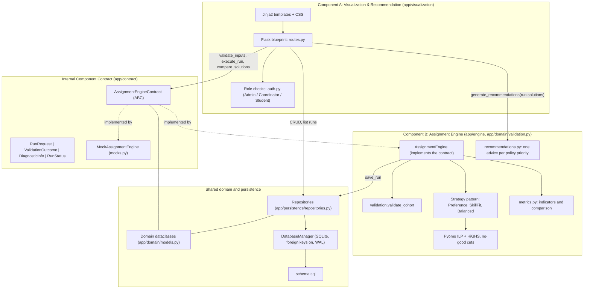
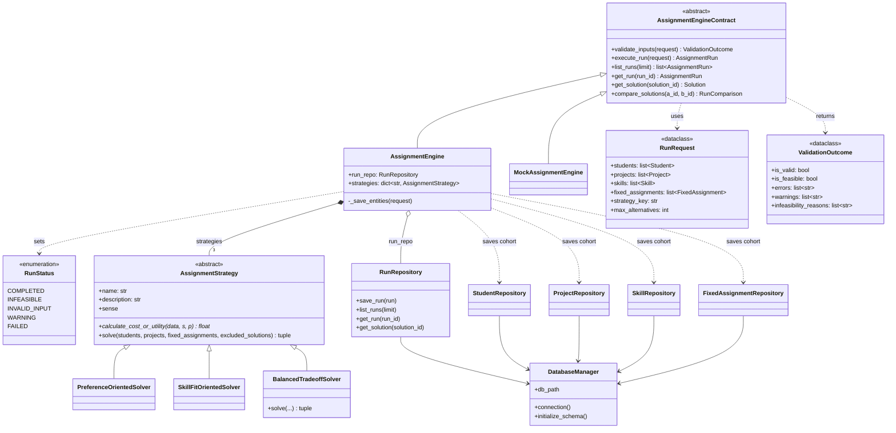
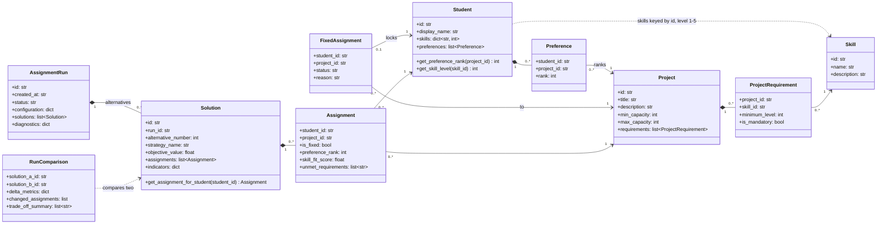
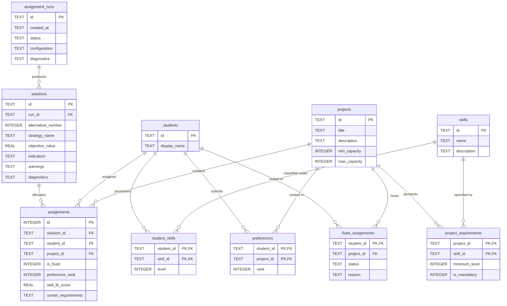

# Deliverable 3: System Architecture Specification & Design Rationale

## 1. Executive Architectural Overview

The **TECH5 Student-to-Project Assignment Decision Support System (DSS)** assigns a cohort of students to semester projects at NHH. An allocation must respect **project capacity bounds**, **mandatory skill requirements** and **administrative locks**, while trading off **student ranked preferences** against **skill fit**. The system computes several distinct alternatives, measures each one, and leaves the final choice to the coordinator.

The system is one Python application with **two components** that only meet at an internal contract:

1. **Component A (Visualization & Recommendation, Team A, `app/visualization/`)**:
   - User workflow, data entry (CRUD), demonstration scenarios, role switching (Administrator, Coordinator, Student Viewer), the run trigger, side-by-side comparison of two alternatives, and the recommendations page.
2. **Component B (Assignment Engine, Team B, `app/engine/` and `app/domain/validation.py`)**:
   - Validates the input, solves an **integer linear programme (ILP)** built in **Pyomo** and solved with **HiGHS** (`appsi_highs`, one thread), generates **distinct alternatives** with integer no-good cuts, computes the evaluation indicators, and saves each run with its diagnostics.

The contract (`app/contract/contract.py`) and the domain objects (`app/domain/models.py`) are shared by both teams, and so is the SQLite persistence layer (`app/persistence/`). The mathematical model itself is documented in `docs/analytical_note.md` §2 and `docs/model/ilp_formulation.tex`.

---

## 2. Component Diagram & Internal Interface



**One optimization run, step by step.** The route builds a `RunRequest` from the stored cohort and calls `AssignmentEngine.execute_run`:

1. **Validate** (`validation.validate_cohort`). Invalid input is saved as `INVALID_INPUT`; input that is provably impossible (for example fewer seats than students) is saved as `INFEASIBLE`. Invalid is reported before infeasible (R10, D16).
2. **Solve.** Alternative 1 uses the strategy the user selected; each next alternative uses the next strategy in turn (R15) and adds a no-good cut for every earlier alternative (R5). The loop stops early when the cuts make the model infeasible.
3. **Measure.** `metrics.compute_solution_indicators` scores every alternative with the same function (feasibility, efficiency, fairness, capacity).
4. **Save.** The run, its solutions and assignments are saved through `RunRepository.save_run` with status `COMPLETED`, `INFEASIBLE` or `FAILED`, and the route redirects to the run page.

The comparison page calls `compare_solutions` (which uses `metrics.compare_two_solutions`), and the recommendations page calls `recommendations.generate_recommendations` on the solutions of one run.

---

## 3. Design Rationale: Two-Component Modular Monolith vs. Microservices

### 3.1 Motivation for In-Process Two-Component Architecture
1. **Curricular Alignment & Feasibility**:
   - The primary pedagogical objective is object-oriented software design, relational database integration, and decision support. Microservices introduce substantial operational complexity (distributed networking, ports, HTTP status translation, retries, serialization boilerplate) that distracts from the core analytical problem.
2. **High Modularity Without Operational Overhead**:
   - Component A and Component B maintain strict separation of concerns. Component B has zero knowledge of Flask request objects, HTML templates, or cookies. It can be instantiated, validated, and tested headlessly in pure Python scripts or test harnesses (`docs/reproducible_demonstration.md` §2.6).
3. **Type Safety**:
   - In-process contract calls pass typed dataclasses (`RunRequest`, `ValidationOutcome`, `AssignmentRun`, `RunComparison`) directly, so there is no JSON schema that can drift between the components.
4. **Performance**:
   - Direct method calls avoid serialization and network latency. Each strategy solves a 300-student cohort in under 0.4 s (`docs/analytical_note.md` §1.2), so the user can wait for the result in the browser.

### 3.2 Decisions Specific to This Implementation
1. **The contract is the only dependency on the engine's internals.** Component A types its engine as `AssignmentEngineContract` and calls only its methods for running and comparing. `MockAssignmentEngine` implements the same contract with synthetic numbers, so Team A could build every page before the real engine existed; the routes fall back to the mock only if the engine raises `NotImplementedError`. Two direct dependencies remain by design: the routes call `generate_recommendations`, which reads nothing but `Solution.indicators`, and the repositories for data entry and for reading saved runs. Both depend on stable keys and tables (R11), not on solver code.
2. **ILP with Pyomo and HiGHS (D1, approved as Q1).** Team B learned this toolchain in TECH4, so every line of the model can be explained by the team. ILP keeps hard constraints exact (R2), proves when no further distinct alternative exists (R5), and makes each strategy an explicit objective function. The reasoning is set out in `docs/analytical_note.md` §1.2.
3. **One model, three objectives.** The sets, parameters and constraints are built once in `prepare_data` and `build_model`; a strategy only supplies the objective coefficient of each `x[s,p]` and the sense (§4.1, D14). A constraint fix therefore applies to all three strategies at once, and the strategies differ only where they should.
4. **Validation before solving.** Clear errors are caught in plain Python with readable messages, before Pyomo is called. The solver only has to prove the harder, combined conflicts infeasible. No constraint is ever relaxed to produce an answer (R2).
5. **Deterministic results (R16).** Sets are built in sorted identifier order and HiGHS runs on one thread, so the same input gives the same alternatives with the same Pyomo and HiGHS versions. The demonstration guide relies on this.

---

## 4. Object-Oriented Architecture & Design Patterns

### 4.1 Strategy Pattern (Assignment Algorithms)
The Assignment Engine defines an abstract base strategy `AssignmentStrategy(abc.ABC)` with three concrete subclasses. All three solve the same model (`analytical_note.md` §2.4); they differ in the objective:
- `PreferenceOrientedSolver`: minimises the total preference rank (unranked projects count as rank $m + 1$, R14), with a small skill-fit tie-break.
- `SkillFitOrientedSolver`: maximises the total skill fit over the non-mandatory requirements (R4), with a small preference tie-break.
- `BalancedTradeoffSolver`: solves in two stages. Stage 1 minimises the worst assigned rank; stage 2 keeps that worst rank and maximises an equal mix ($\lambda = 0.5$) of preference score and skill fit. It is the only strategy that overrides `solve`.

`calculate_cost_or_utility(data, s, p)` is the abstract method each subclass implements; `solve` builds the shared model, adds the objective from these coefficients and any no-good cuts, and calls HiGHS.

```
       +--------------------------------------------+
       |          AssignmentStrategy (ABC)          |
       +--------------------------------------------+
       | + sense                                    |
       | + calculate_cost_or_utility(data, s, p)  * |
       | + solve(students, projects, fixed, cuts)   |
       +--------------------------------------------+
             ^                  ^               ^
             |                  |               |
  +----------+------+   +-------+--------+   +--+--------------------+
  | Preference      |   | SkillFit       |   | BalancedTradeoff      |
  | OrientedSolver  |   | OrientedSolver |   | Solver                |
  | sense = min     |   | sense = max    |   | overrides solve():    |
  |                 |   |                |   | stage 1 min-max rank, |
  |                 |   |                |   | stage 2 balance       |
  +-----------------+   +----------------+   +-----------------------+
```

### 4.2 Abstract Contract Pattern (Component Boundary)
`AssignmentEngineContract` defines the public interface required by Component A: `validate_inputs`, `execute_run`, `list_runs`, `get_run`, `get_solution` and `compare_solutions`. `AssignmentEngine` implements all of them, and `MockAssignmentEngine` implements the same interface with synthetic data, so either can be substituted without touching Component A.

### 4.3 Repository Pattern (Data Access Layer)
Persistence operations are encapsulated into domain repositories:
- `StudentRepository`: Manages `students`, `student_skills`, and `preferences`.
- `ProjectRepository`: Manages `projects` and `project_requirements`.
- `SkillRepository`: Manages defined competencies.
- `FixedAssignmentRepository`: Manages administrative pre-allocation locks.
- `RunRepository`: Manages `assignment_runs`, `solutions`, and `assignments`.

All repositories share one `DatabaseManager`, which turns on foreign-key enforcement for every connection, so an assignment can only refer to a project that exists.

### 4.4 Class Diagram: Contract, Engine and Persistence



The module-level functions are not classes and so are not drawn: `validation.validate_cohort` (returns a `ValidationResult`, which the engine copies into a `ValidationOutcome`), the model functions `prepare_data`, `build_model`, `solve_model` and `read_assignments` in `solvers.py`, `metrics.compute_solution_indicators` and `metrics.compare_two_solutions`, and `recommendations.generate_recommendations` (returns `RecommendationItem` objects).

### 4.5 Class Diagram: Domain Model



All domain objects are dataclasses with `to_dict` and `from_dict`. The diagram mirrors the relational schema in §5: compositions here are the one-to-many tables there, and a student's skills are stored as `student_skills` rows (`StudentSkill`), but held in memory as a dictionary from skill ID to level.

---

## 5. Relational Database Architecture



---

## 6. Role-Based Access Control (RBAC)

The application models three explicit business roles in `app/visualization/auth.py`:
1. **Course Administrator (`ADMIN`)**: Full authorization. Can edit students, projects, skills, and fixed assignments, trigger optimization runs, and switch active roles.
2. **Program Coordinator (`COORDINATOR`)**: Operational authorization. Can manage fixed assignment locks, trigger solver runs, and inspect detailed recommendations and comparisons. Read-only on baseline student data.
3. **Student Viewer (`STUDENT`)**: Transparency view. Can browse anonymized dashboard metrics, project descriptions, and high-level allocation summaries. Mutating actions are disabled.
