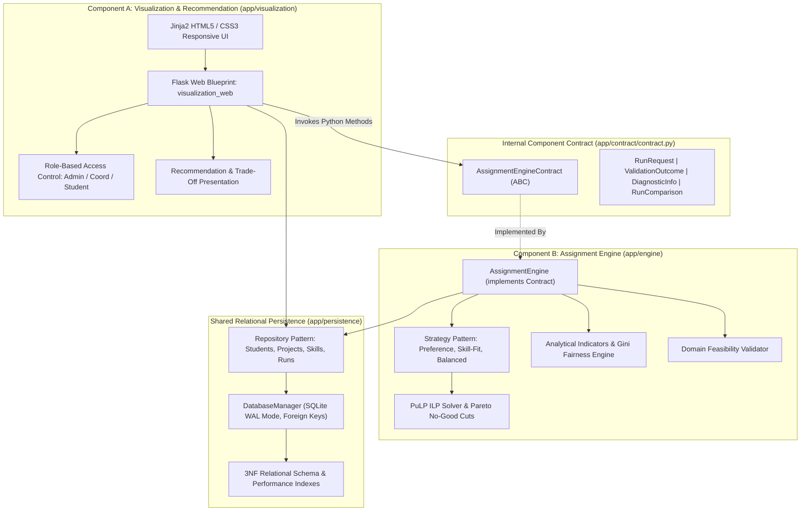
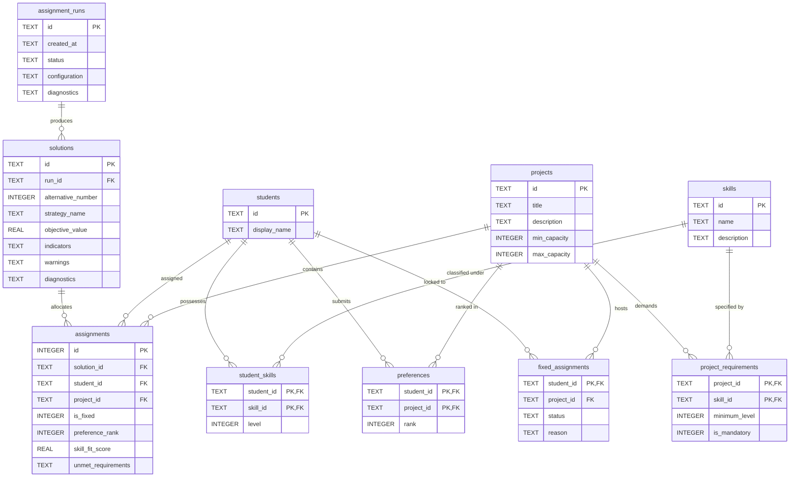

# Deliverable 3: System Architecture Specification & Design Rationale

## 1. Executive Architectural Overview

The **TECH5 Student-to-Project Assignment Decision Support System (DSS)** is an integrated application engineered for the Norwegian School of Economics (NHH). It solves the complex combinatorial allocation problem of assigning a cohort of students to semester research and consulting projects based on multidimensional criteria: **student ranked preferences**, **student skill proficiencies**, **project skill requirements**, **project capacity bounds**, and **administrative pre-allocation locks**.

In accordance with the updated project specification (Sections 5, 7, 8, and 15), the system is architected as **two decoupled, modular application components** running within a single integrated Python application:

1. **Component A (Visualization & Recommendation Component)**:
   - Manages user workflow, cohort data inspection, CRUD interfaces, benchmark scenario seeding, role switching (Admin, Coordinator, Student Viewer), multi-solution visual side-by-side trade-off comparisons, and evidence-backed recommendations.
2. **Component B (Assignment Engine)**:
   - Validates input feasibility, executes mathematical Integer Linear Programming (PuLP) using the **Strategy Pattern** (`PreferenceOrientedSolver`, `SkillFitOrientedSolver`, `BalancedTradeoffSolver`), generates distinct Pareto alternatives via integer no-good cuts, evaluates multidimensional quality/fairness metrics, and captures diagnostics.

The two components are mediated strictly by an **internal Python component contract** (`app/contract/contract.py`), backed by a shared relational SQLite 3NF persistence layer (`app/persistence`).

---

## 2. Component Diagram & Internal Interface



---

## 3. Design Rationale: Two-Component Modular Monolith vs. Microservices

### 3.1 Motivation for In-Process Two-Component Architecture
1. **Curricular Alignment & Feasibility**:
   - The primary pedagogical objective is object-oriented software design, relational database integration, and decision support. Microservices introduce substantial operational complexity (distributed networking, ports, HTTP status translation, retries, serialization boilerplate) that distracts from the core analytical problem.
2. **High Modularity Without Operational Overhead**:
   - Component A and Component B maintain strict separation of concerns. Component B has zero knowledge of Flask request objects, HTML templates, or cookies. It can be instantiated, validated, and tested headlessly in pure Python scripts or test harnesses.
3. **Type Safety & Compiler Diagnostics**:
   - In-process contract calls pass typed dataclasses (`RunRequest`, `ValidationOutcome`, `RunComparison`) directly. Type checkers (`mypy`, `pylint`) and IDEs provide immediate syntax and type validation, eliminating runtime JSON schema mismatch errors.
4. **Performance & Determinism**:
   - Direct method invocations eliminate JSON serialization/deserialization CPU cycles and network socket latency, allowing instant interactive comparison and optimization execution.

---

## 4. Object-Oriented Architecture & Design Patterns

### 4.1 Strategy Pattern (Assignment Algorithms)
The Assignment Engine defines an abstract base strategy `AssignmentStrategy(abc.ABC)` with concrete subclasses:
- `PreferenceOrientedSolver`: Maximizes student ranked preferences (assigning rank 1 awards highest utility, penalizing unranked assignments).
- `SkillFitOrientedSolver`: Maximizes qualification fit across all required project skills.
- `BalancedTradeoffSolver`: Combines normalized preference satisfaction and skill coverage using Pareto scalarization.

```
       +-----------------------------------+
       |     AssignmentStrategy (ABC)      |
       +-----------------------------------+
       | + calculate_cost_or_utility(...)  |
       | + solve(...)                      |
       +-----------------------------------+
             ^               ^          ^
             |               |          |
  +----------+----+   +------+----+   +-+----------------+
  | Preference    |   | SkillFit  |   | BalancedTradeoff |
  | OrientedSolver|   | Solver    |   | Solver           |
  +---------------+   +-----------+   +------------------+
```

### 4.2 Abstract Contract Pattern (Component Boundary)
`AssignmentEngineContract` defines the public interface required by Component A. Concrete `AssignmentEngine` implements all contract methods, ensuring that any mock or alternative solver can be substituted without touching Component A.

### 4.3 Repository Pattern (Data Access Layer)
Persistence operations are encapsulated into domain repositories:
- `StudentRepository`: Manages `students`, `student_skills`, and `preferences`.
- `ProjectRepository`: Manages `projects` and `project_requirements`.
- `SkillRepository`: Manages defined competencies.
- `FixedAssignmentRepository`: Manages administrative pre-allocation locks.
- `RunRepository`: Manages `assignment_runs`, `solutions`, and `assignments`.

---

## 5. Relational Database Architecture



---

## 6. Role-Based Access Control (RBAC)

The application models three explicit business roles in `app/visualization/auth.py`:
1. **Course Administrator (`ADMIN`)**: Full authorization. Can edit students, projects, skills, and fixed assignments, trigger optimization runs, and switch active roles.
2. **Program Coordinator (`COORDINATOR`)**: Operational authorization. Can manage fixed assignment locks, trigger solver runs, and inspect detailed recommendations and comparisons. Read-only on baseline student data.
3. **Student Viewer (`STUDENT`)**: Transparency view. Can browse anonymized dashboard metrics, project descriptions, and high-level allocation summaries. Mutating actions are disabled.
