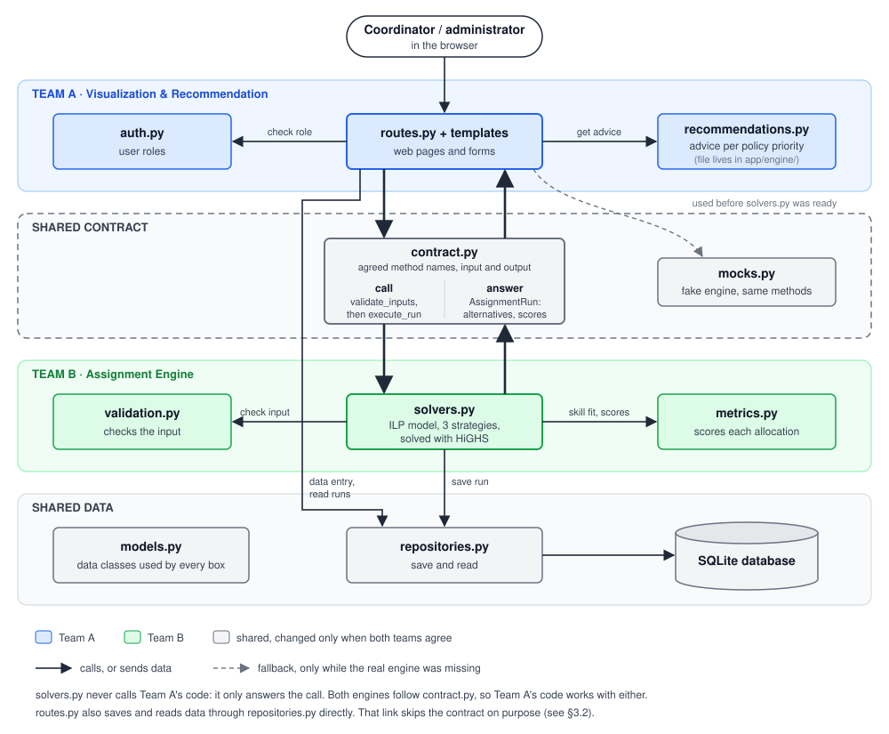

# Component Diagram

## How to read the diagram

- **Read it from top to bottom.** The coordinator works in the browser, and the browser talks to Team A's pages. Team A asks the engine through the shared contract, and Team B's engine does the work. At the bottom is the shared data layer, which stores the result.
- **Colour shows who is responsible.** Blue is Team A, green is Team B, and grey is shared by both teams. Grey files change only if both teams agree.
- **The contract is the only meeting point between the two teams.** The thick arrows pass through `contract.py`. On the left, `routes.py` calls `validate_inputs` and then `execute_run` with the cohort and the chosen strategy. On the right, `solvers.py` answers with an `AssignmentRun`, which holds the alternatives and their scores. `contract.py` fixes the method names and what goes in and comes out. It stores nothing.
- **`mocks.py` follows the same contract with made-up numbers.** The dashed arrow shows that Team A used it while `solvers.py` was unfinished, without changing its own code. The real engine has now replaced it.
- **`solvers.py` never calls Team A's code.** It only answers the call, so the engine also runs without the website.
- **Inside Team B,** `solvers.py` first asks `validation.py` to check the input. After solving, it asks `metrics.py` to score each allocation, and finally it saves the run through `repositories.py`.
- **One arrow skips the contract on purpose.** The thin line on the left goes from `routes.py` straight to `repositories.py`. It is used to enter students and projects and to read saved runs. That is plain storage, not engine work, so it does not need the contract ([architecture.md](../architecture.md) §3.2).
- **Some links are left out to keep the picture simple.** `models.py` has no arrows because every box uses it. `recommendations.py` reads the scores that `metrics.py` saved with each allocation, but that link is not drawn. The file is drawn with Team A because Team A owns it, even though it lives in `app/engine/`.
